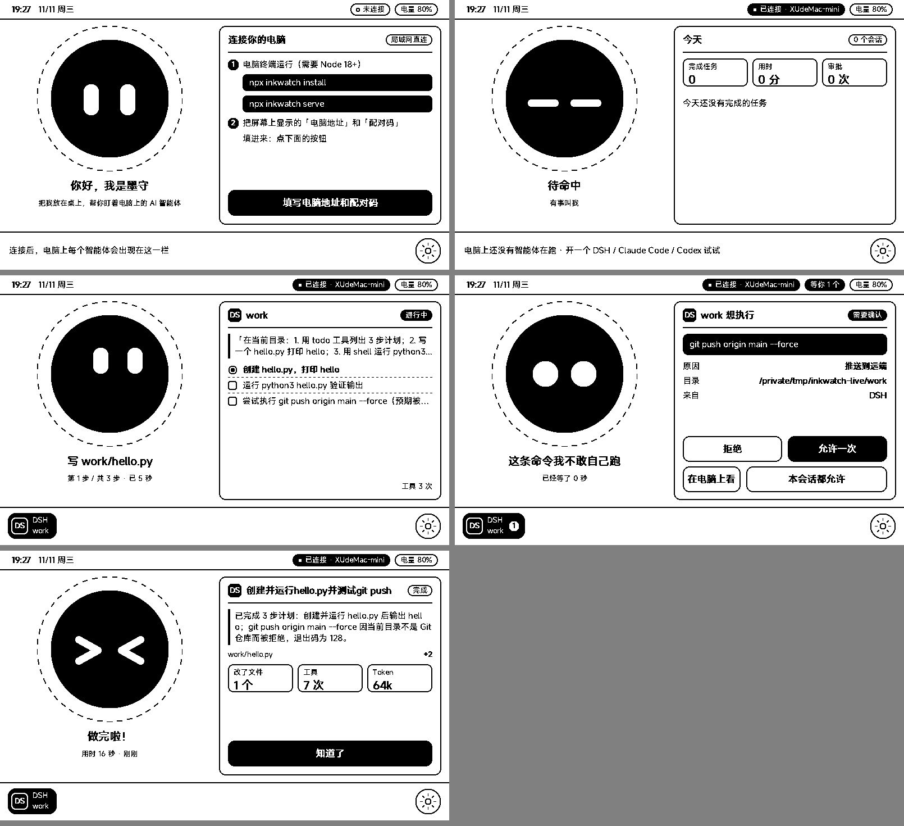

# 墨守 InkWatch

把电脑上 AI 智能体的状态放到桌上的 X4 墨水屏：它在干什么、做到第几步、哪里卡住了；要执行危险命令（`git push`、`rm -rf`、发布、改线上环境……）时，停下来等你在 X4 上点「允许」或「拒绝」。

支持 **DSH（DeepSeek Harness）**、**Claude Code**、**Codex**，Mac 和 Windows 都能用。X4 和电脑在同一个局域网里直连，不经过任何服务器。



| 表情 | 状态 | X4 右边显示 |
|---|---|---|
| 竖眼 | 第一次打开 | 怎么连接你的电脑 |
| 困困 `— —` | 没有任务在跑 | 今天完成了几个任务、最近的任务 |
| 往上看 | 正在干活 | 你下的指令、计划和进度、正在改的文件 |
| 圆眼 | 等你确认 | 它想跑的命令、原因、目录；允许一次 / 拒绝 / 在电脑上看 / 本会话都允许 |
| 生气 | 命令出错 | 报错最后几行 |
| `> <` | 做完了 | 它的总结、改了哪些文件、Token 用量 |

## 安装（Mac / Windows 一样）

需要 Node.js 18 或更新（装过 DSH / Claude Code / Codex 的电脑一般已经有了）。

**1. 电脑上运行一次**（Mac 用「终端」，Windows 用 PowerShell）：

```bash
npx github:linchuanXu/inkwatch install
```

它会：

- 找到电脑上装了哪几家智能体，给它们装上钩子（原有的钩子和设置不动，改之前留 `.bak-inkwatch` 备份）；
- 把自己复制到 `~/.inkwatch/`，设成登录后自动在后台运行；
- 最后显示 X4 要填的**电脑地址**和**配对码**。

第一次运行时系统会问一次网络权限：

- **Mac**：「是否允许 node 接受传入网络连接」→ 允许。
- **Windows**：防火墙弹窗 → 勾「专用网络」→ 允许。漏了这一步 X4 会连不上。

已经开着的智能体要关掉重开一次，钩子才生效。

**2. X4 上**：在商店装「墨守」，打开后点「填写电脑地址和配对码」，填终端里显示的两项。只需要填一次。

## 常用命令

把 `install` 换成别的就行：

```bash
npx github:linchuanXu/inkwatch status
```

| 命令 | 作用 |
|---|---|
| `install [dsh\|claude\|codex]` | 装钩子 + 开机后台运行（默认三家都装） |
| `status` | 后台服务在不在跑，电脑地址和配对码 |
| `pair --new` | 换一个配对码（X4 要重新填） |
| `approve risky\|all\|none` | 哪些命令要在 X4 上确认：只拦危险命令（默认）/ 每条 shell 命令都问 / 只显示不拦 |
| `uninstall` | 卸载钩子和开机自启 |
| `serve` | 前台运行，调试用 |

## 常见问题

**X4 显示「连不上电脑」**
- 电脑和 X4 要连同一个 Wi-Fi（公司访客网络常常不让设备互相访问）。
- 路由器重启后电脑地址可能变了：运行 `status` 看新地址，在 X4 右下角齿轮重新填。想一劳永逸，可以在路由器里给这台电脑固定 IP。
- Windows 检查防火墙是否放行了 Node.js（专用网络）。

**X4 不在身边时会不会卡住智能体？** 不会。X4 超过 90 秒没来取状态，危险命令照常交给智能体自己的确认界面；X4 上 10 分钟没人点，也会交回去。电脑上的后台服务没开时，钩子什么都不做，智能体照常运行。

**Codex**：需要在 `~/.codex/config.toml` 里打开 hooks 功能（按 Codex 文档）。Codex 的钩子只能「拦下」不能「放行」，所以在 X4 上点「允许」等于交给 Codex 自己的确认。

**DSH**：安装时写进 `~/.dsh/profiles/*/cordis.patch.yml`（用 DSH 自带的 Claude Code 钩子兼容桥）。之后新建的 profile，用 `dsh <profile> --patch ~/.inkwatch/dsh-patch.yml`，或再运行一次 `install`。

## 它怎么工作

```
智能体 ──钩子──▶ inkwatch hook ──本机──▶ inkwatch serve（局域网 :47320）◀──长轮询── X4「墨守」
                         ▲                                │
                         └────── 允许 / 拒绝 ◀────────────┘
```

- 每个智能体在开始、调用工具前后、结束时调用 `inkwatch hook`，它把事件转给本机后台服务。
- 工具调用前，如果命令有风险，钩子会挂起，等 X4 的回答（最长 10 分钟）。
- X4 用长轮询向电脑要状态：状态一变马上返回，没有变化就每 20 秒问一次，墨水屏只在状态变化时刷新。
- 只用 Node 自带模块，没有任何依赖；配置和配对码在 `~/.inkwatch/config.json`。

## 安全

- 只在局域网内工作，数据不经过任何服务器。
- X4 必须带配对码才能读状态、回答审批；本机钩子和后台服务之间另有一个只存在本机的密钥。
- 局域网里拿到配对码的人能看到你的智能体在做什么、能替你点允许/拒绝。不放心可以随时 `pair --new` 换码。
- 「本会话都允许」只对当前这一个智能体会话有效，不会永久放权。

## 测试状况

- Mac + DSH：已端到端实测（真 DSH headless 任务 → X4 应用运行时 → 拒绝推送 → DSH 收到拒绝）。
- Claude Code、Codex：按它们的钩子格式写好，尚未实测。
- Windows：代码已处理路径、引号、开机自启、PowerShell 危险命令，尚未在 Windows 上实测。

## 目录

```
bin/inkwatch.mjs   电脑端（钩子、后台服务、安装）
x4/app/            X4 轻应用源码（API 2.21）
test/e2e.sh        端到端测试（Mac / Linux，需装 DSH）
```

MIT License
